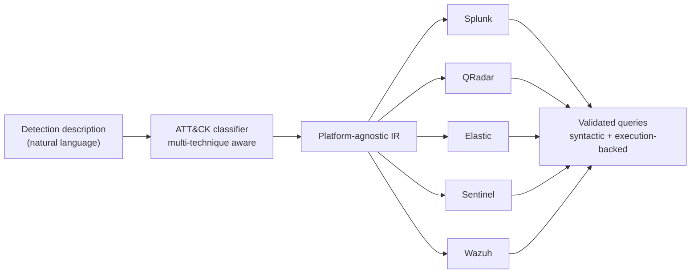

 

-1F6FEB?style=for-the-badge)

### 👋 About

I'm a B.Tech Computer Science student (AI/ML specialisation) at **PES University**, working at the intersection of **security operations and applied AI**.

I'm drawn to problems where the answer that *looks* right and the answer that *is* right quietly diverge. Working in a SOC, that showed up as detection rules that pass every check yet catch nothing, so I built a framework that makes that failure structurally preventable.

### 🎤 Featured Talk

<table>
<tr>
<td width="72%">

**NL-SIEM at Black Hat Arsenal India 2026** 
📅 30 October 2026 &nbsp;·&nbsp; 🤝 Co-presented with **Dr Swetha P**

Live demonstration of a multi-agent LLM framework that translates detections across SIEM platforms **without losing MITRE ATT&CK coverage**, presented to the international security community on the Black Hat Arsenal stage.

</td>
<td width="28%" align="center">

 

</td>
</tr>
</table>

### 🔬 Featured Research: NL-SIEM

> **Detecting What You Think You Detect: Cross-Platform SIEM Query Generation and Prevention of ATT&CK Coverage Drift using Intermediate Representation and LLMs**
> *Bhat, S.D. & Swetha P. · preprint under review · PESU C-ISFCR*

A coverage heatmap can stay green while the detection behind it silently stops working once it is ported to another SIEM. I named this failure mode **ATT&CK Coverage Drift** and built a multi-agent LLM framework that prevents it by design. ATT&CK classification, including cases where one description maps to several techniques, happens *before* any query is generated. The result is folded into a platform-agnostic IR and handed to independent translation agents.

### 🧭 Skills & Evidence

Every claim is mapped to the work that backs it, along with an honest level of depth.

| Domain | Level | Evidence |
|---|:---:|---|
| Security / Detection Engineering |  | NL-SIEM validated in SOC use, live Elastic + Wazuh connectors |
| Machine Learning / Retrieval |  | CodeBERT fine-tuning, FAISS @ 51K vectors, 0.80 MRR@10 |
| Full-Stack (React / FastAPI / Flask) |  | 3 shipped projects, each with a working frontend and API |
| Geospatial Analysis |  | UIDAI pipeline, GeoPandas, fuzzy entity resolution |
| Large-scale Distributed Systems |  | Coursework and personal-project scale |

### 🚀 Projects

<b>🔎 Semantic Code Search Engine</b> · CodeBERT bi-encoder + FAISS retrieval at 51K-snippet scale

 

**Problem:** keyword search doesn't understand code semantics. "Sort a list" misses idiomatic implementations that share no vocabulary with the query.

**Approach:** fine-tuned a CodeBERT bi-encoder with an InfoNCE contrastive objective on CodeSearchNet pairs (Python, Java, Go), indexed with FAISS `IndexFlatIP`.

**Result:** 8.06 ms median / 9.76 ms P95 retrieval latency and 0.80 MRR@10, competitive with commercial code search. Shipped with FastAPI + React (ranked results, inline previews, per-language filtering).

<b>🗺️ Geospatial Analysis of Aadhaar Service Demand & Infrastructure Stress</b> · resolved 42 of 58 inconsistent district names

 

**Problem:** UIDAI datasets use inconsistent state and district naming across sources, which breaks joins against GeoJSON boundaries.

**Approach:** Unicode normalisation + RapidFuzz `token_sort_ratio` (threshold 85); four ratio-based infrastructure stress metrics with z-score / IQR outlier detection.

**Result:** auto-resolved 42 of 58 name variants. Key finding: high-volume districts do *not* uniformly show high update pressure, which surfaced non-obvious, policy-relevant gaps.

<b>🛡️ Web Vulnerability Scanner</b> · multi-threaded BFS crawler with LLM-generated remediation reports

 

**Problem:** scan output is usually a raw findings dump that developers must interpret themselves.

**Approach:** multi-threaded BFS crawler with a thread-safe visited set; SQLi / XSS payload injection with pattern-matched response analysis to cut false positives.

**Result:** the OpenAI API turns findings into readable explanations with prioritised remediation, exported as structured JSON for CI/CD gating.

<b>🎬 Movie Box Office Revenue Prediction</b> · XGBoost + Random Forest ensemble on right-skewed TMDB data

 

**Problem:** box office revenue is heavily right-skewed, which breaks naive regression and lets tail blockbusters dominate the loss.

**Approach:** log-scale transform, cross-validated XGBoost + Random Forest ensemble with grid-search tuning; multi-hot genre encoding, cyclical seasonality, budget normalisation.

**Result:** minimised RMSE while limiting overfitting on outlier blockbuster revenue.

### 🧰 Tech Stack

**Languages & Frameworks** 

  

**ML, Data & Tooling** 

### 🎯 Currently

- 🔭 Extending NL-SIEM with multi-technique ATT&CK classification and Splunk / QRadar / Sentinel connectors
- 🛡️ SOC Intern at **PESU C-ISFCR**: detection engineering, alert triage, incident investigation, cross-platform coverage
- 🎓 Teaching Assistant for **Digital Logic and Computer Design** at PES University
- 🎤 Running competitive programming workshops for **Aura Club** (50+ participants)
- 📚 Presenting deep-dives on transformers and LLM alignment for **AIML SIG**

### 🏅 Recognition

| | |
|---|---|
| 🎤 **Black Hat Arsenal India 2026** | Presenter, NL-SIEM (30 Oct 2026) |
| 🎓 **MRD Scholarship** | PES University, 2025 & 2026 |
| 🎓 **CNR Scholarship** | PES University, 2025 |

### 📊 GitHub Stats

 

### 🤝 Let's Connect

Open to conversations on **SIEM, threat detection, MITRE ATT&CK, and applying AI to security problems**.

